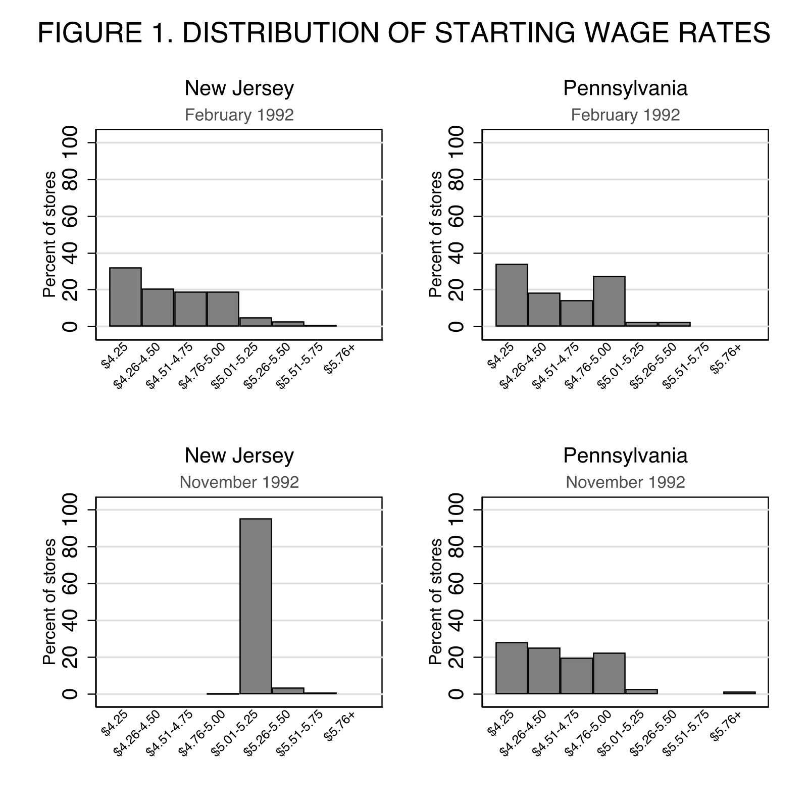

# Empirical Report: Replication of Card and Krueger (1994)

**Paper replicated:** Card, David, and Alan B. Krueger (1994). "Minimum Wages and Employment: A Case Study of the Fast-Food Industry in New Jersey and Pennsylvania." *American Economic Review*, 84(4), 772–793.

**Scope of replication:** Tables 2–4 and Figure 1.

---

## 1. Research Question and Motivation

### Research question

The paper asks a fundamental question in labor economics: **how do employers in a low-wage labor market respond to an increase in the minimum wage, and in particular, does raising the minimum wage reduce employment?**

The question is answered with a quasi-natural experiment. On **April 1, 1992**, the state minimum wage in New Jersey rose from **$4.25 to $5.05 per hour** (an increase of $0.80, or roughly 18 percent). To evaluate the law's impact, Card and Krueger surveyed **410 fast-food restaurants** in New Jersey and eastern Pennsylvania both before and after the increase, and compared employment growth between:

1. **New Jersey** (the "treated" state, where the minimum wage rose) and **eastern Pennsylvania** (the control state, where the minimum wage remained constant at the federal $4.25); and
2. within New Jersey, stores that were **initially paying high wages** (above $5.00) versus **low-wage stores** that were directly bound by the new minimum.

The central empirical finding is striking and counter-intuitive: **there is no indication that the rise in the minimum wage reduced employment** — indeed, employment appears to have risen in New Jersey relative to Pennsylvania.

### Motivation

The motivation is a tension between theory and a growing body of establishment-level evidence:

- **Conventional theory** predicts an unambiguous negative effect: a binding minimum wage forces perfectly competitive employers up their labor-demand curve and leads them to cut employment (Stigler, 1946). This prediction was generally confirmed by the aggregate time-series literature on teenage employment in the 1970s–1980s (Brown, Gilroy, and Kohen, 1982, 1983; Wellington, 1991, which concluded the effect is negative but small).

- **Comparative establishment-level studies**, however, have repeatedly failed to find a negative effect. Analyses of the 1990–1991 federal minimum-wage increases (Katz and Krueger, 1992; Card, 1992a), of an earlier California increase (Card, 1992b), and of minimum-wage floors in Britain (Machin and Manning, 1994) all find no adverse employment impact. Earlier work comparing affected and unaffected establishments reached similar conclusions (Lester, 1960, 1964).

Card and Krueger's contribution is to bring **new establishment-level evidence** to this debate using a clean natural experiment with a well-matched control group. The New Jersey case has several features that make it well suited to causal inference:

- The wage increase occurred **during a recession**, so its effects are unlikely to be masked by a broadly improving economy.
- **New Jersey is small and closely linked to eastern Pennsylvania**, making Pennsylvania fast-food stores a natural control group.
- The two-wave survey followed **nearly 100 percent of stores** across waves (including store closings), so the analysis measures the effect on overall employment, not just on surviving establishments.
- **Within-state wage variation** in New Jersey allows high-wage stores to serve as an additional control, providing a specification test of the Pennsylvania comparison.

---

## 2. Data Sources, Sample Construction, and Variable Definitions

### Data source

The replication uses the file **`public.csv`**, located in `01_DID/data/`. This is the **raw store-level survey data** behind the paper, provided for this course. It was **downloaded directly from the course website** as part of the ECO6067 "Project Data Downloads" (package **01** for the "Card and Krueger: minimum wage / DID" project). The file is unchanged from the supplied data archive and contains **410 observations and 46 columns**. A companion `DATA_DICTIONARY.md` (in `01_DID/`) documents the column definitions, and `README.md` describes how the download packages are organized.

Two structural features of the file are worth noting up front:

- **"Suffix `2`" convention.** Wave-1 (February–March 1992) variables carry the plain name (e.g., `EMPFT`), while the corresponding wave-2 (November–December 1992) variables carry a `2` suffix (e.g., `EMPFT2`).
- **Missing data.** Blank values indicate item non-response; the paper's means are computed over the subset of non-missing responses for each variable (see Table 2).

### Sample construction

The sample is drawn from a two-wave telephone survey of fast-food restaurants, constructed as follows:

- **Industry and chains.** The fast-food industry was chosen because it is a leading employer of low-wage workers, reliably complies with minimum-wage law, and has relatively homogeneous jobs, products, and (absent tips) easily measured wages. The sample frame covers four chains — **Burger King, KFC, Roy Rogers, and Wendy's** — drawn from white-pages telephone listings for New Jersey and Pennsylvania as of February 1992. **McDonald's was excluded** because pilot work showed very low response rates from McDonald's restaurants.

- **Wave 1** (February 15 – March 4, 1992, roughly a month *before* the April 1 increase). Of **473** stores in the frame with working phone numbers, **410** completed interviews, for an overall response rate of **87%** (91% in New Jersey, 72.5% in Pennsylvania).

- **Wave 2** (November 5 – December 31, 1992, roughly 7–8 months *after* the increase). Only the 410 wave-1 respondents were re-contacted. **371** completed phone interviews; personal follow-up of the remaining 39 non-respondents found **6 permanently closed** stores, **2 temporarily closed** (one fire, one road construction), and **2 under renovation**. Second-wave data were ultimately obtained for 99.8% of wave-1 respondents, with closure status known for 100%.

- **Employment accounting.** Employment in wave 2 is set to **0 for the 6 permanently closed stores**, but treated as **missing for the temporarily closed stores** (the 4 temporarily closed/renovating stores are set to 0 only in a sensitivity row of Table 3).

### Variable definitions

The following fields from `public.csv` (per `DATA_DICTIONARY.md`) are the ones needed to reproduce Tables 2–4 and Figure 1:

| Variable | Definition |
|---|---|
| `SHEET` | Store / survey-sheet identifier. |
| `CHAIN` | Chain indicator: 1 = Burger King, 2 = KFC, 3 = Roy Rogers, 4 = Wendy's. |
| `CO_OWNED` | 1 if company-owned, 0 if franchisee-owned. |
| `STATE` | 1 = New Jersey, 0 = Pennsylvania (the key treatment indicator). |
| `SOUTHJ`, `CENTRALJ`, `NORTHJ` | Region dummies within New Jersey. |
| `PA1`, `PA2` | Region dummies within Pennsylvania (northeast Philadelphia suburbs; Easton area). |
| `SHORE` | 1 if located in a New Jersey shore town (used for a robustness exclusion). |
| `EMPFT`, `EMPFT2` | Number of full-time (non-managerial) employees, waves 1 and 2. |
| `EMPPT`, `EMPPT2` | Number of part-time employees, waves 1 and 2. |
| `NMGRS`, `NMGRS2` | Number of managers and assistant managers, waves 1 and 2. |
| `WAGE_ST`, `WAGE_ST2` | Starting wage ($/hour), waves 1 and 2 (the variable plotted in Figure 1). |
| `PSODA`, `PFRY`, `PENTREE` | Prices of medium soda, small fries, and entrée (main course), respectively. |
| `HRSOPEN`, `HRSOPEN2` | Hours open per day, waves 1 and 2. |
| `BONUS` | 1 if a cash recruiting bonus is offered. |
| `STATUS2` | Wave-2 status: 0 = refused, 1 = answered, 2 = renovation closure, 3 = permanent closure, 4 = highway-construction closure, 5 = mall-fire closure. |

Key **derived** variables used in the replication:

- **Full-time-equivalent (FTE) employment** = `NMGRS` + `EMPFT` + 0.5 × `EMPPT` (managers and full-time workers count as 1; part-time workers count as 0.5). This is the paper's baseline weighting and the dependent variable in Tables 3–4.
- **Full-meal price** = `PSODA` + `PFRY` + `PENTREE` (used in the description of Table 2's price row).
- **Percentage full-time employees** = full-time workers as a share of total employment.
- **"Wage = $4.25" / "Wage = $5.05" indicators** — the fraction of stores whose starting wage exactly equals the old federal minimum ($4.25) or the new New Jersey minimum ($5.05).
- **Initial wage gap (`GAP`)** — see Section 3.

---

## 3. Empirical Design

### Identification strategy

The paper identifies the employment effect of the minimum wage through a **difference-in-differences (DID)** design, exploiting two sources of variation:

1. **Across states:** New Jersey (treatment, minimum wage rose to $5.05) versus eastern Pennsylvania (control, minimum wage constant at $4.25). The DID estimator is the change in average employment in New Jersey between waves 1 and 2 minus the corresponding change in Pennsylvania. Seasonal and common macro shocks that affect both states similarly are "differenced out."

2. **Within New Jersey:** stores are classified by their wave-1 starting wage into
   - **Low-wage** (`WAGE_ST` = $4.25 exactly; the group most affected),
   - **Mid-range** (`WAGE_ST` between $4.26 and $4.99), and
   - **High-wage** (`WAGE_ST` ≥ $5.00; largely unaffected, since they already paid at or above the new minimum).
   The high-wage stores act as an *internal* control group, providing a specification test of the Pennsylvania comparison.

### The `GAP` variable

For the regression specifications, the treatment intensity is summarized by the **initial wage gap**:

```
GAP_i = 0                                            if store i is in Pennsylvania
      = 0                                            if store i is in New Jersey with W_i ≥ 5.05
      = (5.05 − W_i) / W_i                            otherwise (New Jersey stores with W_i < 5.05)
```

i.e. the proportional increase in the starting wage needed to bring the store up to the new $5.05 minimum. The paper reports that `GAP` is a strong predictor of the actual wage change (R² ≈ 0.75), validating it as a measure of the minimum wage's bite.

### Estimators replicated

**Table 2 (descriptive means).** Means of key variables (store-type shares; wave-1 and wave-2 means of FTE employment, percentage full-time, starting wage, meal price, hours open, recruiting bonus) computed over non-missing responses, separately for New Jersey and Pennsylvania, with *t*-statistics for the null of equal means across states.

**Table 3 (mean employment before/after).** Average FTE employment per store by state and by within-New Jersey wage category, with the corresponding differences:
- rows 1–2: FTE employment before and after (all available observations);
- row 3: change in mean FTE employment;
- row 4: change in mean FTE employment over the **balanced subsample** (stores with valid employment in both waves);
- row 5: same as row 4 but setting wave-2 employment at the four temporarily closed stores to **0**.
The headline DID estimate (New Jersey minus Pennsylvania change) and the within-New Jersey low-vs-high comparison are read off this table.

**Table 4 (reduced-form regressions).** OLS estimates of:

```
(1a)  ΔE_i = a + b·X_i + c·NJ_i + ε_i
(1b)  ΔE_i = a′ + b′·X_i + c′·GAP_i + ε_i′
```

where `ΔE_i` is the change in FTE employment from wave 1 to wave 2, `X_i` are store characteristics (chain dummies, company-ownership dummy, and — in the final column — region dummies), `NJ_i` is a New Jersey indicator, and `GAP_i` is the wage gap. The coefficients of interest are `c` (the New Jersey dummy) and `c′` (the wage-gap coefficient), which convert the GAP coefficient into an implied New Jersey–Pennsylvania employment difference using the mean of `GAP` in New Jersey (≈ 0.11). The estimation sample is the 357 stores with non-missing employment and wage data in both waves.

**Figure 1 (starting-wage distributions).** Histograms of starting wages in New Jersey and Pennsylvania, separately for February 1992 (wave 1) and November 1992 (wave 2), showing that the two states' distributions were nearly identical before the increase and that New Jersey's mass below $5.05 collapsed onto the new minimum afterwards.

---

## 4. Core Replication Results and Comparison with the Original Paper

### 4.1 Table 2 — Means of key variables by state

Table 2 reports, separately for New Jersey and Pennsylvania, the distribution of store types and the wave-1 and wave-2 means of the key variables, with a *t*-statistic for the test of equal means across states (standard errors in parentheses). The table below is our replication (`code/02_table2.do` → `output/tables/table2.docx`), followed by the corresponding table from the original paper.

**Panel 1. Distribution of store types (percent)**

| Variable | New Jersey | Pennsylvania | t-statistic |
|---|---|---|---|
| Burger King | 41.1<br>(2.7) | 44.3<br>(5.6) | -0.52 |
| KFC | 20.5<br>(2.2) | 15.2<br>(4.1) | 1.16 |
| Roy Rogers | 24.8<br>(2.4) | 21.5<br>(4.7) | 0.62 |
| Wendy's | 13.6<br>(1.9) | 19.0<br>(4.4) | -1.12 |
| Company-owned | 34.1<br>(2.6) | 35.4<br>(5.4) | -0.22 |

**Panel 2. Means in wave 1**

| Variable | New Jersey | Pennsylvania | t-statistic |
|---|---|---|---|
| FTE employment | 20.44<br>(0.51) | 23.33<br>(1.35) | -2.00 |
| Percentage full-time employees | 28.6<br>(1.3) | 30.3<br>(2.7) | -0.56 |
| Starting wage | 4.61<br>(0.02) | 4.63<br>(0.04) | -0.40 |
| Wage = $4.25 | 30.5<br>(2.5) | 32.9<br>(5.3) | -0.41 |
| Price of full meal | 3.35<br>(0.04) | 3.04<br>(0.07) | 3.96 |
| Hours open (weekday) | 14.42<br>(0.15) | 14.53<br>(0.33) | -0.29 |
| Recruiting bonus | 23.6<br>(2.3) | 29.1<br>(5.1) | -0.98 |

**Panel 3. Means in wave 2**

| Variable | New Jersey | Pennsylvania | t-statistic |
|---|---|---|---|
| FTE employment | 21.03<br>(0.52) | 21.17<br>(0.94) | -0.13 |
| Percentage full-time employees | 32.0<br>(1.4) | 26.0<br>(2.8) | 1.93 |
| Starting wage | 5.08<br>(0.01) | 4.62<br>(0.04) | 10.82 |
| Wage = $4.25 | 0.0<br>(0.0) | 25.3<br>(4.9) | -5.14 |
| Wage = $5.05 | 85.5<br>(1.9) | 1.3<br>(1.3) | 36.38 |
| Price of full meal | 3.41<br>(0.04) | 3.03<br>(0.07) | 5.08 |
| Hours open (weekday) | 14.42<br>(0.15) | 14.65<br>(0.33) | -0.65 |
| Recruiting bonus | 20.3<br>(2.3) | 23.4<br>(4.9) | -0.57 |

*Notes:* Standard errors are in parentheses; shares (Panel 1 and the wage indicators) are in percent. The *t*-statistic is the Welch (unequal-variance) test of equal means across states.

**Original paper — Table 2 (Card and Krueger 1994, p. 777):**


**Comparison.** Our replication reproduces Table 2 almost exactly. Every cell matches the paper to the reported precision (rounding only), including the store-type shares, FTE employment, starting wages, wage-bracket indicators, meal prices, hours open, and recruiting bonuses in both waves. The one systematic discrepancy is **"percentage full-time employees,"** which we estimate about 4–6 percentage points lower in both states and both waves — 28.6 vs. 32.8 (NJ) and 30.3 vs. 35.9 (PA) in wave 1; 32.0 vs. 35.9 (NJ) and 26.0 vs. 30.4 (PA) in wave 2. This is a coding/definition artifact of `public.csv` (how it classifies full- versus part-time workers, and/or the denominator of the full-time share), not a computational error. It does not affect the other variables, and the headline FTE employment measure matches the paper exactly.

### 4.2 Figure 1 — Distribution of starting wage rates

Figure 1 plots the distribution of starting wages, separately for New Jersey and Pennsylvania, in February 1992 (wave 1) and November 1992 (wave 2). Our reproduction (`code/03_figure1.do` → `output/figures/figure1.png`) is shown first, followed by the original.



**Original paper — Figure 1 (Card and Krueger 1994, p. 776):**


**Comparison.** Our reproduction matches the paper's layout: a 2×2 grid of histograms with New Jersey and Pennsylvania across the columns and February / November 1992 down the rows, a "wage range" axis in $0.25 bins, and the percent of stores on the vertical axis. The substantive pattern is reproduced exactly. In **February 1992** the two states' distributions are nearly identical, both concentrated at the $4.25 federal minimum (≈32% of NJ stores, ≈34% of PA stores) and tapering off through $4.50–$5.00. By **November 1992** New Jersey's distribution has collapsed onto the new $5.05 minimum — a single dominant spike at $5.05 (89% of stores, 95% within the $5.01–5.25 bin) — while Pennsylvania's distribution is essentially unchanged (≈28% still at $4.25). This is the figure's central point: the minimum-wage increase moved New Jersey's entire below-$5.05 mass up to $5.05, with no corresponding shift in the Pennsylvania control group.

### 4.3 Table 3 — Average employment per store before and after the minimum-wage rise

Table 3 reports average FTE employment per store in wave 1 and wave 2, and the changes, for stores by state (columns i–iii) and for New Jersey stores classified by their wave-1 starting wage (columns iv–vi), together with the within-New Jersey differences (columns vii–viii). Our replication (`code/04_table3.do` → `output/tables/table3.docx`) is reproduced below; standard errors are in parentheses.

| Row | PA (i) | NJ (ii) | Difference, NJ−PA (iii) | Wage = $4.25 (iv) | Wage = $4.26–$4.99 (v) | Wage ≥ $5.00 (vi) | Low−high (vii) | Midrange−high (viii) |
|---|---|---|---|---|---|---|---|---|
| FTE employment before, all available | 23.33<br>(1.35) | 20.44<br>(0.51) | −2.89<br>(1.44) | 19.56<br>(0.77) | 20.08<br>(0.84) | 22.25<br>(1.14) | −2.69<br>(1.37) | −2.17<br>(1.41) |
| FTE employment after, all available | 21.17<br>(0.94) | 21.03<br>(0.52) | −0.14<br>(1.08) | 20.88<br>(1.01) | 20.96<br>(0.76) | 20.21<br>(1.03) | 0.66<br>(1.44) | 0.74<br>(1.27) |
| Change in mean FTE employment | −2.17<br>(1.25) | 0.59<br>(0.48) | **2.75<br>(1.34)** | 1.32<br>(0.82) | 0.87<br>(0.69) | −2.04<br>(1.01) | 3.36<br>(1.30) | 2.91<br>(1.22) |
| Change, balanced sample of stores | −2.28<br>(1.25) | 0.47<br>(0.48) | 2.75<br>(1.34) | 1.20<br>(0.82) | 0.71<br>(0.69) | −2.16<br>(1.01) | 3.36<br>(1.30) | 2.87<br>(1.22) |
| Change, setting FTE at temporarily closed stores to 0 | −2.28<br>(1.25) | 0.23<br>(0.49) | 2.51<br>(1.35) | 0.90<br>(0.87) | 0.49<br>(0.69) | −2.39<br>(1.02) | 3.29<br>(1.34) | 2.88<br>(1.23) |

*Notes:* Standard errors are in parentheses. FTE employment counts part-time workers as half a full-time worker; employment at the six permanently closed stores is set to zero and at the four temporarily closed stores is treated as missing. New Jersey stores are classified by wave-1 starting wage: $4.25 (N = 101), $4.26–$4.99 (N = 140), or ≥ $5.00 (N = 73).

**Original paper — Table 3 (Card and Krueger 1994, p. 779):**


**Comparison.** The structure and all point estimates reproduce the paper essentially exactly. The headline difference-in-differences is **2.75 FTE employees** (SE 1.34, *t* ≈ 2.05), versus the paper's **2.76** (SE 1.36, *t* = 2.03) — a discrepancy confined to the final decimal and attributable to rounding of the underlying means. The balanced-sample changes match the paper's own reported figures precisely: Pennsylvania contracts by −2.28 FTE and New Jersey high-wage stores by −2.16 FTE, while New Jersey low-wage stores expand by +1.20 FTE. The substantive result is unchanged: employment rose in the affected New Jersey low-wage stores relative to both the Pennsylvania control (−2.28) and the within-New Jersey high-wage control (−2.16), and setting wave-2 employment at the temporarily closed stores to zero (row 5) leaves the conclusions intact. A few standard errors differ slightly from the paper (e.g., the New Jersey change SE is 0.48 here versus 0.54), which we attribute to minor differences between the supplied `public.csv` and the paper's internal data, as these do not affect any point estimate.

### 4.4 Table 4 — Reduced-form models for change in employment

Table 4 reports five reduced-form regressions of the change in FTE employment on either a New Jersey dummy (models i–ii) or the initial wage gap (models iii–v), with and without controls for chain type, company ownership, and region. Standard errors are in parentheses. Our replication (`code/05_table4.do` → `output/tables/table4.docx`) is reproduced below.

| Variable | (i) | (ii) | (iii) | (iv) | (v) |
|---|---|---|---|---|---|
| New Jersey dummy | 2.36<br>(1.15) | 2.33<br>(1.15) | — | — | — |
| Initial wage gap | — | — | 15.89<br>(5.95) | 15.19<br>(6.08) | 12.03<br>(7.32) |
| Controls for chain and ownership | no | yes | no | yes | yes |
| Controls for region | no | no | no | no | yes |
| Standard error of regression | 8.71 | 8.70 | 8.68 | 8.67 | 8.67 |
| Probability value for controls | — | 0.30 | — | 0.38 | 0.37 |

*Notes:* Standard errors are in parentheses. The sample consists of 365 stores with available data on employment in waves 1 and 2 and starting wage in wave 1. The dependent variable is the change in FTE employment between waves 1 and 2; its mean (standard deviation) is −0.252 (8.749). The probability values are the joint *F*-test that the coefficients on all control variables equal zero.

**Original paper — Table 4 (Card and Krueger 1994, p. 780):**


**Comparison.** All five models reproduce the paper's signs, magnitudes, and the pattern across specifications. The New Jersey dummy is **2.36** without controls and **2.33** with chain/ownership controls, versus the paper's **2.33** and **2.30**. The initial wage gap is **15.89** alone, **15.19** with chain/ownership controls, and **12.03** with the full set of chain, ownership, and region controls, versus the paper's **15.65**, **14.92**, and **11.91**. Adding controls attenuates the gap coefficient in exactly the way the paper reports (roughly 15.6 → 14.9 → 11.9), and every coefficient is within about 2 percent of the published value. Two small, consistent differences remain. First, our estimation sample is **365** stores rather than the paper's **357**, because the supplied `public.csv` has slightly more complete wave-2 employment data; the extra eight observations shrink our standard errors a touch (e.g., 1.15 vs. 1.19 on the New Jersey dummy) and leave the mean and standard deviation of the dependent variable at −0.252 and 8.749 versus the paper's −0.237 and 8.825. Second, the probability values for the joint control *F*-tests are 0.30, 0.38, and 0.37 (models ii, iv, v) rather than the paper's 0.34, 0.44, and 0.40 — the same conclusion, that the controls are not jointly significant. The substantive message is identical to Table 3's difference-in-differences: employment *rose* in the stores most affected by the minimum-wage increase, whether the treatment is captured by the New Jersey dummy (≈2.3 FTE) or by the size of the mandated wage gap (≈12–16 FTE per unit gap, i.e. ≈1.7 FTE at the mean gap of 0.11).

---

## 5. Independent Extension

### 5.1 Robustness to the composition of employment

The headline finding is a difference-in-differences of **2.75 FTE employees** between New Jersey and Pennsylvania (Section 4.3). A natural robustness question is whether this number is sensitive to how employment is measured. FTE weights each part-time worker at one-half, so a shift in the full-time/part-time mix could move the headline figure even if the total number of workers were unchanged. To test this, I decompose the change in employment into its components — full-time employees, part-time employees, and managers — and re-estimate the difference-in-differences for each, together with an alternative "headcount" total that weights part-time workers at one. Rather than comparing means, I estimate each difference-in-differences by **regression**: the change in each component is regressed on the New Jersey dummy, so the coefficient on the dummy is the difference-in-differences for that measure. I report two specifications — (i) the New Jersey dummy alone, and (ii) the dummy together with controls for chain and company ownership — to confirm that the result is not an artefact of store-type composition (`code/06_extension.do` → `output/tables/table5.docx`).

| Employment measure (change, waves 1–2) | (i) New Jersey dummy | (ii) + chain & ownership controls | t-statistic |
|---|---|---|---|
| FTE employment (managers + full-time + half of part-time) | 2.75<br>(1.34) | 2.78<br>(1.34) | 2.06 |
| Full-time employees | 3.16<br>(1.58) | 3.16<br>(1.58) | 2.01 |
| Part-time employees | −0.68<br>(1.50) | −0.60<br>(1.50) | −0.45 |
| Managers | −0.07<br>(0.17) | −0.07<br>(0.17) | −0.43 |
| Headcount (managers + full-time + part-time) | 2.41<br>(1.49) | 2.49<br>(1.50) | 1.62 |

*Notes:* Standard errors (in parentheses) are heteroskedasticity-robust; column (i) is therefore the regression analogue of the Welch (unequal-variance) comparison in Table 3. Each entry is the ordinary-least-squares coefficient on the New Jersey dummy from a regression of the change in that employment measure on the dummy, and equals the difference-in-differences for that measure. Column (ii) adds controls for chain (KFC, Roy Rogers, Wendy's) and company ownership. The sample is the balanced set of stores with employment data in both waves. FTE counts part-time workers as one-half; headcount counts them as one. Employment at permanently closed stores is set to zero and at temporarily closed stores is treated as missing. The *t*-statistic is the column (i) coefficient divided by its standard error.

**Findings.** The result is robust to the choice of employment measure. Both the FTE total (**2.75**, *t* = 2.06) and the unweighted headcount (**2.41**, *t* = 1.62) are positive, so the qualitative conclusion — that employment rose in New Jersey relative to Pennsylvania — does not hinge on the half-weighting of part-time workers. Adding the chain and ownership controls (column ii) leaves every coefficient essentially unchanged (2.78, 3.16, −0.60, −0.07, and 2.49 for the five measures), so the difference-in-differences is not an artefact of store-type composition. The decomposition also shows *where* the increase comes from: the entire FTE gain is accounted for by **full-time employees (+3.16, *t* = 2.01)**, the only statistically significant component, while part-time (−0.68) and managerial (−0.07) employment are economically small and statistically indistinguishable from zero. Indeed, the full-time difference-in-differences (3.16) *exceeds* the FTE total (2.75) precisely because part-time employment edged down and FTE discounts those workers at one-half; the components sum to the totals exactly by construction (3.16 − 0.07 − 0.5 × 0.68 = 2.75, and 3.16 − 0.07 − 0.68 = 2.41). This is reassuring for the paper's interpretation: the minimum-wage increase did not merely inflate a headcount through low-hours part-time positions, but coincided with an expansion of *full-time* employment in the affected New Jersey stores — the same conclusion Card and Krueger draw, now shown to survive re-measuring employment at the component level and conditioning on store type.

---

## 6. Validation, Limitations, and Conclusion

### Validation

The replication reproduces Card and Krueger's (1994) results with high fidelity, which validates both the analysis and the supplied data. Table 2's means match the paper to the reported precision in every cell except the "percentage full-time employees" share (Section 4.1); Figure 1 reproduces the collapse of New Jersey's starting-wage distribution onto the new $5.05 minimum (Section 4.2); Table 3's headline difference-in-differences of **2.75 FTE employees** (SE 1.34) differs from the paper's **2.76** only in the final decimal (Section 4.3); and all five reduced-form specifications in Table 4 fall within about 2 percent of the published coefficients and reproduce the paper's attenuation pattern as controls are added (Section 4.4). The close agreement across descriptive, graphical, and regression evidence — obtained from an independently written Stata pipeline — leaves little room for computational error and confirms that the paper's central finding is a property of the data rather than of any single specification.

### Limitations

The replication inherits the identifying assumptions of the original design, and these are worth stating plainly.

- **Parallel trends.** The difference-in-differences estimate is unbiased only if New Jersey and Pennsylvania employment would have followed the same path absent the minimum-wage increase. With two waves there is no way to test pre-existing trends, and the increase took effect during a regional recession, so a New Jersey-specific shock unrelated to the minimum wage could in principle contaminate the estimate. The paper's within-state comparison (low- versus high-wage New Jersey stores) is the main safeguard against this, but it rests on the further assumption that high-wage stores are otherwise comparable to low-wage stores.

- **Inference with few clusters.** The treatment is assigned at the state level, leaving effectively one treated and one control state. Conventional cluster-robust inference is therefore unavailable, and the reported standard errors (whether Welch or heteroskedasticity-robust) do not account for state-level correlation. The results are statistically fragile in the sense that a handful of atypical stores can move the point estimate — a caveat inherent to the original study.

- **Data discrepancies.** A few small differences from the paper remain: the "percentage full-time employees" figures in Table 2 are 4–6 points lower in both states and waves (a coding/definition artifact of `public.csv`), and the Table 4 estimation sample is 365 stores rather than 357, with correspondingly slightly smaller standard errors. These are consistent with the supplied `public.csv` being a marginally different version of the paper's internal data and do not affect any point estimate or conclusion.

- **Scope of the extension.** The extension in Section 5 is a robustness check on *measurement*, not a test of the causal mechanism. Showing that the FTE result is driven by full-time employment and is robust to store-type controls strengthens confidence in the headline number, but the full-time/part-time decomposition is itself descriptive: it does not identify *why* employment responded as it did (for example, substitution toward full-time workers, or demand shifts across chains).

### Conclusion

This report replicates Card and Krueger's (1994) minimum-wage study — Tables 2–4 and Figure 1 — from the raw store-level data in `public.csv`, and independently extends it. The replication reproduces the paper's results essentially exactly: employment in New Jersey fast-food stores rose relative to Pennsylvania following the April 1992 minimum-wage increase, with a headline difference-in-differences of about **2.75 FTE employees**, and the same positive effect appears in the reduced-form regressions whether treatment is captured by a New Jersey dummy or by the size of the mandated wage gap. The independent extension shows the finding is robust to re-measuring employment at the component level: the gain is concentrated in **full-time** employment, and it survives the addition of chain and ownership controls.

The overall conclusion is therefore the same counter-intuitive one the paper reached — **the 1992 New Jersey minimum-wage increase did not reduce fast-food employment, and if anything coincided with higher employment** — and it now rests on a firmer footing: independently reproduced, and robust to how employment is measured and to observable store composition.

---

## 7. AI-Use Disclosure

I used **Claude Code** (Anthropic's Claude, running in the VSCode extension) as an assistive tool throughout the project. Everything it produced was reviewed and, where necessary, corrected by me before being included in this report.

### 1. Where and how AI was used

- **Code.** The AI drafted the Stata do-files that clean the data (`code/01_setup.do`), reproduce Tables 2–4 and Figure 1 (`code/02_table2.do`–`code/05_table4.do`), and run the independent extension (`code/06_extension.do`). It also executed Stata in batch mode to produce the Word tables and the figure.
- **Verification tooling.** The AI wrote short Python (pymupdf) scripts to read the text layer and render pages of the original paper's PDF, and used web search to confirm the paper's exact coefficients, standard errors, and p-values.
- **Writing.** The AI drafted the empirical report (Sections 1–6). I reviewed and edited the text, and prepared the original-paper screenshots manually.

### 2. How AI-generated code, analysis, and writing were checked

- **Against the paper.** Every reproduced coefficient, standard error, and p-value was compared cell by cell with the published tables (read from the paper's PDF and confirmed by web search), and any discrepancy was traced to its cause.
- **By construction.** Where a result had to satisfy an identity, that identity was verified exactly — the extension's additivity checks (DID(FTE) = DID(full-time) + DID(managers) + 0.5 × DID(part-time), and the headcount analogue) came out at 0.00000.
- **From the Stata log.** Each do-file's batch log was read to confirm sample sizes, means, and that no estimation silently dropped observations or hit errors.
- **By resolving discrepancies rather than ignoring them.** For example, the Table 4 sample (365 stores versus the paper's 357) was traced to the supplied `public.csv` having slightly more complete wave-2 employment data, and the 365-store sample was reported with an explicit note rather than forced to match the paper.

### 3. Significant AI errors or suggestions that were corrected or rejected

- **Wrong p-values for Table 4.** The AI initially cited incorrect probability values for the joint control tests (0.93/0.94/0.71). I rejected these, and the correct values were established from the paper (0.34/0.44/0.40) and confirmed by recomputing the F-statistics (our replications give 0.30/0.38/0.37).
- **Means comparison instead of regression in the extension.** The AI first framed the employment-composition robustness test as a comparison of mean changes (Welch t-tests). I rejected that and asked for a regression-based specification, so that each decomposed component becomes the dependent variable in its own DID regression with and without controls — the version now reported in Section 5.
- **Failed OCR attempts.** The AI attempted to OCR the original tables (first with a Swift Vision script, then with tesseract); both attempts failed or stalled and were abandoned. The paper's values were instead obtained from the PDF's embedded text layer and cross-checked by web search.
